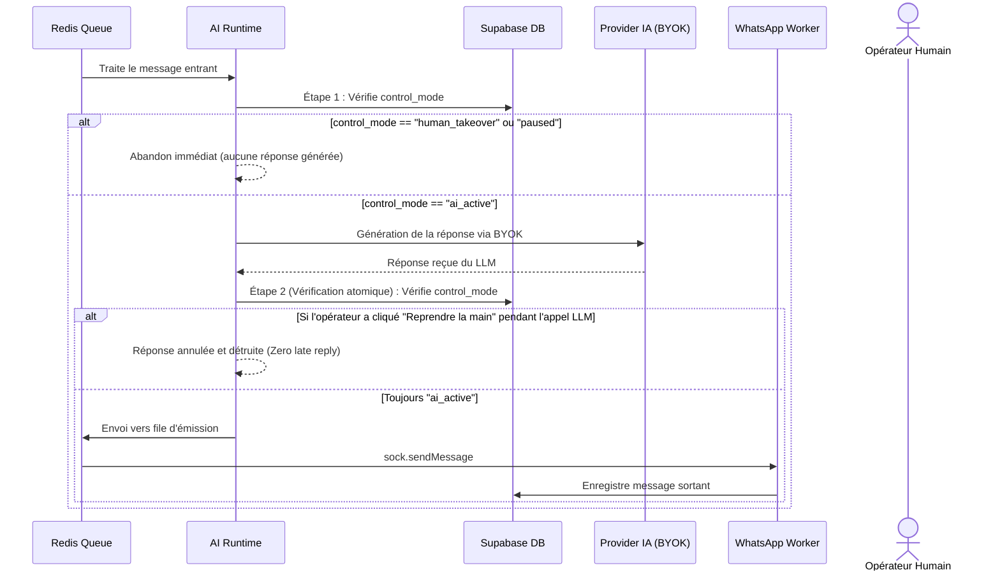

# INNOICA WhatsApp Agents — Moteur d'Exécution IA (AI Runtime)

**Version :** 2.0  
**Statut :** Spécification Technique & Fonctionnelle

---

## 1. Responsabilités du Service `innoica-ai-runtime`

Le service `innoica-ai-runtime` est un processus Node.js / TypeScript indépendant qui gère :
1. La consommation des messages entrants mis en file d'attente Redis (`BullMQ`).
2. Le déchiffrement ponctuel et sécurisé des clés API des clients (BYOK).
3. L'assemblage du prompt avec injection de l'identité de l'agent, des règles métier, de la mémoire et des connaissances pertinentes.
4. L'appel vers le fournisseur IA choisi (OpenRouter, Groq, Google Gemini, OpenAI).
5. La validation de la réponse générée.
6. La double vérification atomique du mode de contrôle humain avant transmission au worker WhatsApp.

---

## 2. Architecture BYOK (Bring Your Own Key)

L'utilisateur configure sa propre clé API via le dashboard. Chaque clé est stockée dans la table `ai_credentials` sous forme chiffrée.

### Adaptateurs Fournisseurs Disponibles :
1. **OpenRouter (`openrouter`)** :
   - Accès aux modèles open-source et propriétaires (Llama 3.3, Mistral, Claude, DeepSeek).
   - Base URL : `https://openrouter.ai/api/v1`
   - Headers spécifiques : `HTTP-Referer` et `X-Title` INNOICA.
2. **Groq (`groq`)** :
   - Infèrence ultra-rapide (Llama 3.3 70B Versatile, Mixtral 8x7b).
   - Base URL : `https://api.groq.com/openai/v1`
3. **Google Gemini (`gemini`)** :
   - SDK officiel `@google/genai` ou API REST compatible.
   - Modèles : `gemini-1.5-flash`, `gemini-1.5-pro`, `gemini-2.0-flash`.
4. **OpenAI (`openai`)** :
   - Modèles : `gpt-4o`, `gpt-4o-mini`.

### Gestion des Erreurs et Transparence :
- **Clé invalide (`auth_error`)** : Alerte immédiate sur le dashboard client avec invitation à renouveler la clé.
- **Quota dépassé (`quota_exceeded`)** : Marquage explicite de l'erreur sans fallback payant silencieux.
- **Fournisseur en panne (`provider_unavailable`)** : Journalisation et notification dans les logs d'exécution.

---

## 3. Gestion de la Mémoire à Deux Niveaux

### Niveau 1 : Mémoire de Conversation (Court terme)
- Conserve les $N$ derniers messages échangés entre le contact et l'agent (par défaut les 10 à 20 derniers messages).
- Fournit la continuité immédiate de l'échange (questions complémentaires, références relatives).

### Niveau 2 : Mémoire Durable du Contact (Long terme)
- Stocke des entités clés associées au contact WhatsApp dans `contact_memories` :
  - Nom / Prénom déclaré.
  - Préférences (ex: plat préféré, créneau horaire souhaité, type de produit recherché).
  - Notes de contexte (ex: client régulier, entreprise de logistique).
- Chargée dynamiquement au début de chaque interaction pour personnaliser l'accueil.
- L'utilisateur peut consulter, corriger ou purger cette mémoire depuis son dashboard.

---

## 4. Protocole Human Takeover (Reprise en main Humaine)

### Règle d'Or :
Aucune réponse IA ne doit jamais être envoyée si un opérateur humain est intervenu sur la conversation. La vérification atomique juste avant l'envoi garantit l'absence de collision temporelle.
