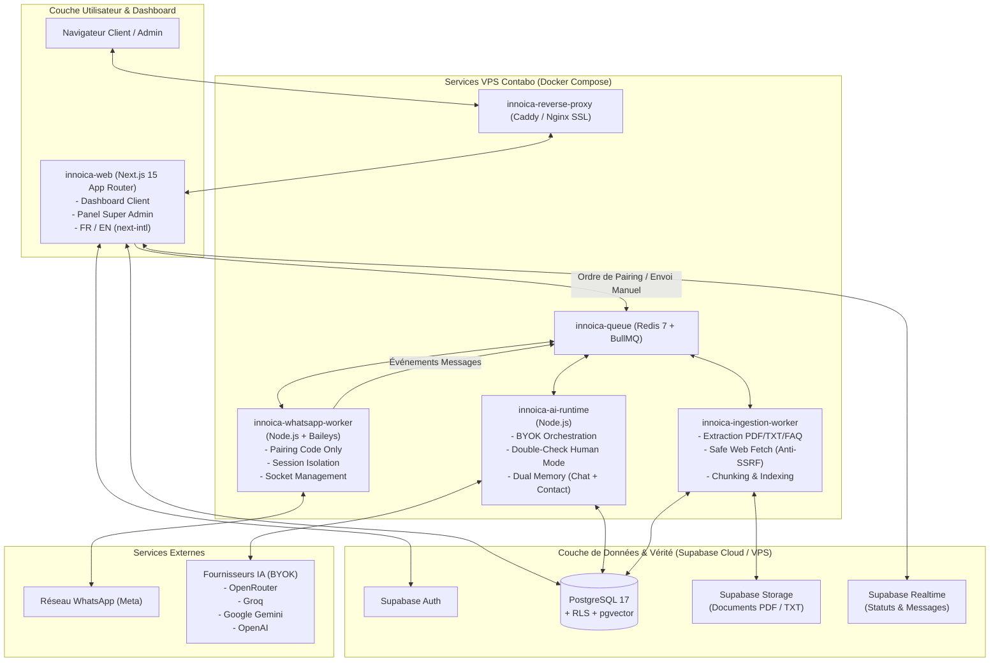
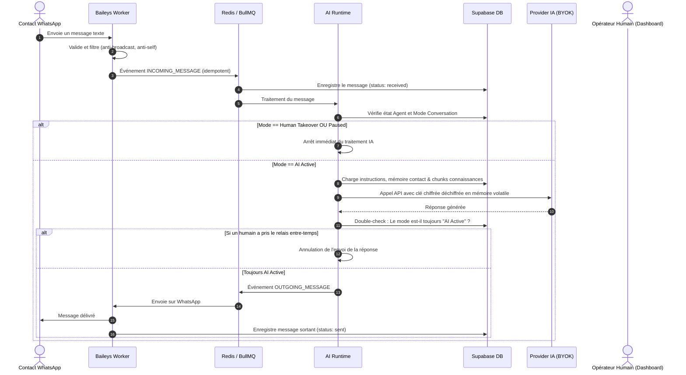

# INNOICA WhatsApp Agents — Spécification d'Architecture Technique

**Version :** 2.0  
**Statut :** Spécification de référence

---

## 1. Vue d'ensemble du système

---

## 2. Découpage des Composants et Responsabilités

### 2.1 `apps/web` (Application Web & API routes Next.js)
- **Rôle :** Interface utilisateur SaaS, gestion des workspaces, configuration des agents, monitoring, boîte de réception humaine, administration.
- **Règles :**
  - Aucune clé API stockée en clair côté client.
  - Saisie du numéro WhatsApp avec validation internationale E.164.
  - Réception en temps réel des Pairing Codes générés par le Worker.
  - Contrôle d'accès strict via RLS Supabase et vérifications serveurs.

### 2.2 `services/whatsapp-worker`
- **Rôle :** Gestionnaire de sockets WhatsApp via la bibliothèque Baileys.
- **Fonctionnalités :**
  - Initialisation de session isolée par agent.
  - Exécution de `sock.requestPairingCode(phoneNumber)` à la demande.
  - Émission du code temporaire à 8 caractères vers Supabase/Redis pour affichage client.
  - Écoute des messages entrants (`messages.upsert`).
  - Déduplication via identifiant de message WhatsApp (`msg.key.id`).
  - Envoi des messages sortants (`sock.sendMessage`).
- **Garantie absolue :** Aucun QR Code n'est jamais demandé, calculé ou stocké.

### 2.3 `services/ai-runtime`
- **Rôle :** Cerveau d'orchestration conversationnelle.
- **Fonctionnalités :**
  - Dépouillement des messages depuis la file BullMQ.
  - Vérification de l'état de l'agent (`active` uniquement).
  - **Vérification 1 :** Contrôle du mode de conversation (`Human Takeover` => interruption immédiate).
  - Récupération du contexte : instructions système du modèle + mémoire de conversation récente + mémoire durable du contact.
  - Recherche sémantique dans les fragments de connaissances associés.
  - Appel au fournisseur d'IA configuré via le connecteur BYOK correspondant.
  - **Vérification 2 :** Re-vérification atomique du mode conversation avant envoi vers la file d'émission pour éviter toute réponse tardive en cas de prise de contrôle humaine concurrente.

### 2.4 `services/ingestion-worker`
- **Rôle :** Traitement documentaire asynchrone pour la base de connaissances.
- **Fonctionnalités :**
  - Extraction de texte à partir de PDF et fichiers TXT.
  - Scraping d'URL publiques avec module de validation SSRF strict (rejet immédiat de toute IP locale, privée, link-local, loopback, ou métadonnées cloud).
  - Découpage en fragments cohérents (chunking) et stockage dans PostgreSQL.

---

## 3. Flux d'un message entrant (Séquence pas-à-pas)

