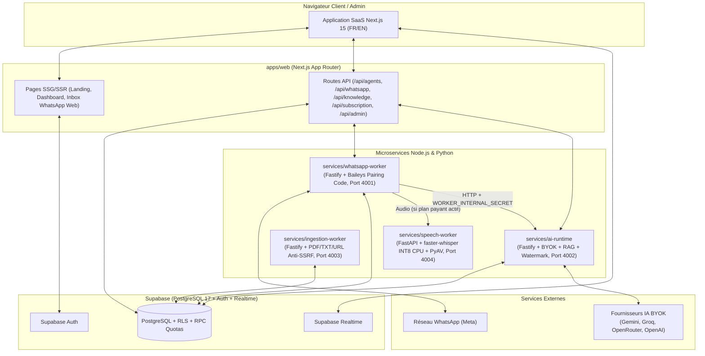

# Innoica Agent Studio — Architecture Technique

**Version :** 2.1  
**Monorepo :** `pnpm workspaces` + Node.js 24 + TypeScript strict  

---

## 1. Vue d'Ensemble du Système

---

## 2. Découpage des Packages & Services

### 2.1 `packages/shared`
- **Entrée client (`@innoica/shared`) :** Types TypeScript (`WorkspaceQuotaSnapshot`, `PlanSlug`, etc.), `PLAN_CATALOG` (source de vérité Free/Starter), `APP_CONFIG`, `AI_PROVIDERS_CONFIG`, `applyPlanWatermark`, `sanitizeKnowledgeContent`, schémas Zod (`paymentDeclarationSchema`, `adminPaymentDecisionSchema`, etc.), utilitaires E.164 (`parseE164Phone`, `formatE164Phone`).
- **Entrée serveur (`@innoica/shared/server`) :**
  - `security/encryption.ts` : Chiffrement/déchiffrement AES-256-GCM des clés BYOK.
  - `security/ssrf.ts` : `safeFetchPublicUrl` avec validation DNS pré-vol et inspection à chaque redirection HTTP.
  - `knowledge/pdf.ts` : Validation signature `%PDF-` et limite 10 Mo + extraction texte PDF (`pdf-parse`).

### 2.2 `apps/web` (Port `3000`)
- Next.js 15.5 App Router + `next-intl` (`fr` défaut sans préfixe obligatoire, `en` sur `/en`).
- Routes API authentifiées via cookie SSR Supabase + `getActiveWorkspaceContext(supabase)`.
- Appels vers `services/whatsapp-worker` protégés par `WORKER_INTERNAL_SECRET`.

### 2.3 `services/whatsapp-worker` (Port `4001`)
- Gestionnaire de sockets Baileys multi-sessions (`sessions/<agentId>`).
- `printQRInTerminal: false` strictement imposé ; génération exclusive de Pairing Code (`sock.requestPairingCode`).
- Persistance et reconnexion automatique avec verrou de session (`isConnected` + verrou anti-reconnexion concurrente) et détection de conflits multi-connexions.
- Déduplication des messages entrants sur `wa_message_id` puis transfert authentifié vers `services/ai-runtime`.

### 2.4 `services/ai-runtime` (Port `4002`)
- Réception des événements messages depuis le WhatsApp Worker (`POST /api/generate-response`).
- **Séquence d'exécution stricte :**
  1. Vérification du mode de conversation (`control_mode === 'ai_active'`).
  2. Réservation atomique du quota via RPC `reserve_ai_reply_quota` (fuseau `Africa/Douala`).
  3. Récupération du contexte : prompt système + mémoire durable contact (`contact_memories`) + mémoire conversation (`conversation_memories`) + chunks RAG délimités par `<untrusted_knowledge>`.
  4. Déchiffrement BYOK en mémoire + appel au fournisseur IA.
  5. **Double vérification atomique Human Takeover** juste avant envoi WhatsApp ; en cas d'annulation ou d'échec, appel de `release_ai_reply_quota`.
  6. Application déterministe de la signature INNOICA via `applyPlanWatermark` selon `hasWatermark` du plan.
  7. Envoi via WhatsApp Worker + confirmation `confirm_ai_reply_quota` avec `wa_message_id`.

### 2.5 `services/ingestion-worker` (Port `4003`)
- Fastify (`bodyLimit: 15 Mo`), endpoints `/api/ingest/faq`, `/api/ingest/txt`, `/api/ingest/pdf`, `/api/ingest/url`.
- Respect des limites du plan (`max_knowledge_docs`, `allowed_knowledge_types`) et protection anti-SSRF stricte sur URL.

### 2.6 `services/speech-worker` (Port `4004`)
- Service Python FastAPI dédié à la transcription vocale locale (`faster-whisper 1.2.1` + `ctranslate2 4.8.1` INT8 CPU + `av 15.1.0` OGG/Opus en mémoire, sans `ffmpeg.exe` externe ni API payante).
- Endpoints `/health`, `/api/hardware-audit`, `/api/transcribe` protégés par `WORKER_INTERNAL_SECRET`.
- Décode OGG/Opus, MP3, WAV, MP4/M4A, FLAC, WebM en PCM 16 kHz mono après inspection binaire magic-bytes, vérifie la taille/durée/activité vocale, libère immédiatement les tampons en mémoire et ne journalise jamais d'audio ni de transcriptions.
