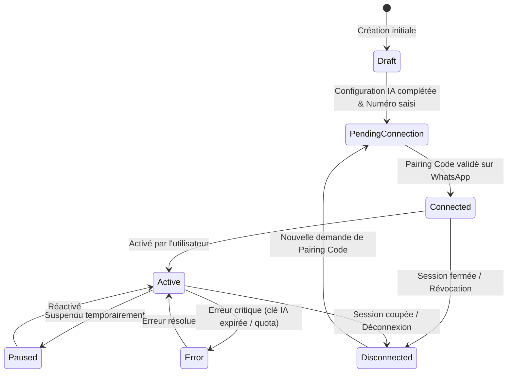

# INNOICA WhatsApp Agents — Règles Métier et Logique Applicative

**Version :** 2.0  
**Statut :** Spécification de Référence

---

## 1. Cycle de Vie et États d'un Agent

Un agent suit un cycle d'états stricts défini par la machine à états suivante :

### Règle d'Activation Inviolable :
Un agent **NE PEUT PAS** passer à l'état `Active` si :
1. Sa connexion WhatsApp n'est pas à l'état `connected`.
2. Sa configuration IA (clé API BYOK valide et modèle sélectionné) n'est pas renseignée et testée.
3. Son prompt système est vide.

---

## 2. Modèles d'Agents (Templates Métier)

Chaque template fournit un prompt système spécialisé et des structures de données préconçues :

### 2.1 Receptionist Agent (Prioritaire)
- **Objectif :** Accueil, présentation de l'entreprise, orientation, horaires, FAQ, transfert vers un opérateur.
- **Règle :** Si la question sort du périmètre de l'accueil ou des connaissances fournies, l'agent propose courtoisement de transférer la conversation à un conseiller humain.

### 2.2 Sales Agent
- **Objectif :** Présentation du catalogue produits/services, qualification des besoins du prospect, recueil de l'intention d'achat.
- **Règle :** Ne jamais inventer de prix non stipulé dans les connaissances. Transmettre l'intention d'achat à l'équipe commerciale.

### 2.3 Support Agent
- **Objectif :** Dépannage, consultation des FAQ/documents techniques, collecte des détails du problème.
- **Règle :** Escalade automatique si le problème n'est pas résolu en 3 échanges ou si le client exprime une forte insatisfaction.

### 2.4 Booking Agent
- **Objectif :** Collecte des demandes de rendez-vous (nom, date souhaitée, créneau horaire, motif).
- **Règle absolue :** **Aucune confirmation définitive de disponibilité ne doit être inventée** en l'absence d'un calendrier connecté. L'agent indique toujours : "Votre demande de réservation a été enregistrée pour le [date]. Notre équipe vous confirmera la disponibilité sous peu."

### 2.5 Restaurant Agent
- **Objectif :** Présentation du menu, horaires d'ouverture, prise de commande ou réservation de table.
- **Règle :** Récapituler fidèlement la commande et le numéro de téléphone avant transmission en cuisine/salle.

### 2.6 Custom Agent
- **Objectif :** Instructions et personnalité totalement configurables par l'utilisateur pour des besoins spécifiques.

---

## 3. Règle Un Numéro = Un Agent

- Chaque connexion WhatsApp est strictement liée à un agent unique (`agent_id` unique dans `whatsapp_connections`).
- Un numéro de téléphone WhatsApp ne peut pas être partagé entre plusieurs agents simultanément.
- Si un utilisateur tente d'associer un numéro déjà connecté sur un autre agent (même au sein du même workspace), le système rejette la demande avec une erreur explicite.

---

## 4. Quotas et Limites par Plan d'Abonnement

Les limitations de ressources sont vérifiées **côté serveur** avant toute opération :

| Paramètre | Plan Starter | Plan Pro | Plan Enterprise |
|---|---|---|---|
| Nombre d'agents | 1 | 3 | Illimité (selon accord) |
| Connexions WhatsApp | 1 | 3 | Multi-numéros |
| Documents de connaissances | 3 max (PDF/TXT) | 20 max | 100+ |
| Taille max par document | 2 Mo | 10 Mo | 25 Mo |
| Mémoire de contact durable | Activée | Activée | Activée |
| Périodicité | Mensuelle / Annuelle | Mensuelle / Annuelle | Annuelle |
