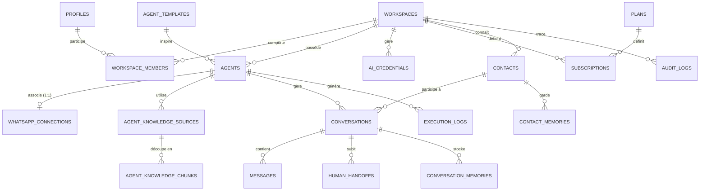

# INNOICA WhatsApp Agents — Schéma de Base de Données (PostgreSQL / Supabase)

**Version :** 2.0  
**Statut :** Spécification de référence

---

## 1. Liste des Tables & Relations



---

## 2. Définition Détaillée des Tables

### 2.1 Utilisateurs, Profils & Workspaces

#### `profiles`
- `id` : `uuid PRIMARY KEY REFERENCES auth.users(id) ON DELETE CASCADE`
- `email` : `text NOT NULL`
- `full_name` : `text`
- `avatar_url` : `text`
- `is_super_admin` : `boolean DEFAULT false` (Bootstrap sécurisé uniquement)
- `created_at` : `timestamptz DEFAULT now()`
- `updated_at` : `timestamptz DEFAULT now()`

#### `workspaces`
- `id` : `uuid PRIMARY KEY DEFAULT gen_random_uuid()`
- `name` : `text NOT NULL`
- `slug` : `text UNIQUE NOT NULL`
- `owner_id` : `uuid REFERENCES profiles(id) ON DELETE RESTRICT`
- `plan_id` : `uuid REFERENCES plans(id)`
- `created_at` : `timestamptz DEFAULT now()`
- `updated_at` : `timestamptz DEFAULT now()`

#### `workspace_members`
- `id` : `uuid PRIMARY KEY DEFAULT gen_random_uuid()`
- `workspace_id` : `uuid REFERENCES workspaces(id) ON DELETE CASCADE`
- `user_id` : `uuid REFERENCES profiles(id) ON DELETE CASCADE`
- `role` : `text NOT NULL CHECK (role IN ('owner', 'admin', 'member'))`
- `created_at` : `timestamptz DEFAULT now()`
- *Contrainte UNIQUE(workspace_id, user_id)*

---

### 2.2 Modèles & Agents

#### `agent_templates`
- `id` : `uuid PRIMARY KEY DEFAULT gen_random_uuid()`
- `slug` : `text UNIQUE NOT NULL` (ex: `receptionist`, `sales`, `support`, `booking`, `restaurant`, `custom`)
- `name_fr` : `text NOT NULL`
- `name_en` : `text NOT NULL`
- `description_fr` : `text NOT NULL`
- `description_en` : `text NOT NULL`
- `default_system_prompt_fr` : `text NOT NULL`
- `default_system_prompt_en` : `text NOT NULL`
- `suggested_features` : `jsonb DEFAULT '{}'::jsonb`
- `created_at` : `timestamptz DEFAULT now()`

#### `agents`
- `id` : `uuid PRIMARY KEY DEFAULT gen_random_uuid()`
- `workspace_id` : `uuid REFERENCES workspaces(id) ON DELETE CASCADE`
- `template_id` : `uuid REFERENCES agent_templates(id)`
- `name` : `text NOT NULL`
- `description` : `text`
- `avatar_url` : `text`
- `primary_language` : `text DEFAULT 'fr' CHECK (primary_language IN ('fr', 'en'))`
- `system_prompt` : `text NOT NULL`
- `personality_traits` : `text[] DEFAULT '{}'`
- `status` : `text DEFAULT 'draft' CHECK (status IN ('draft', 'pending_connection', 'connected', 'active', 'paused', 'error', 'disconnected'))`
- `is_memory_enabled` : `boolean DEFAULT true`
- `ai_credential_id` : `uuid REFERENCES ai_credentials(id)`
- `ai_provider` : `text NOT NULL DEFAULT 'openrouter'`
- `ai_model` : `text NOT NULL DEFAULT 'meta-llama/llama-3.3-70b-instruct'`
- `ai_temperature` : `numeric DEFAULT 0.7`
- `created_at` : `timestamptz DEFAULT now()`
- `updated_at` : `timestamptz DEFAULT now()`

---

### 2.3 Connexion WhatsApp (1 Numéro = 1 Agent)

#### `whatsapp_connections`
- `id` : `uuid PRIMARY KEY DEFAULT gen_random_uuid()`
- `workspace_id` : `uuid REFERENCES workspaces(id) ON DELETE CASCADE`
- `agent_id` : `uuid UNIQUE REFERENCES agents(id) ON DELETE CASCADE`
- `phone_number` : `text UNIQUE NOT NULL` (Format international +237...)
- `status` : `text DEFAULT 'pending' CHECK (status IN ('pending', 'pairing', 'connected', 'disconnected', 'error'))`
- `pairing_code` : `text` (Temporaire, effacé une fois connecté)
- `pairing_code_expires_at` : `timestamptz`
- `last_connected_at` : `timestamptz`
- `disconnect_reason` : `text`
- `created_at` : `timestamptz DEFAULT now()`
- `updated_at` : `timestamptz DEFAULT now()`

#### `whatsapp_sessions`
- `id` : `uuid PRIMARY KEY DEFAULT gen_random_uuid()`
- `connection_id` : `uuid UNIQUE REFERENCES whatsapp_connections(id) ON DELETE CASCADE`
- `encrypted_auth_state` : `text` (Chiffré AES-256-GCM hors du frontend)
- `session_version` : `integer DEFAULT 1`
- `updated_at` : `timestamptz DEFAULT now()`

---

### 2.4 Intelligence Artificielle & BYOK

#### `ai_credentials`
- `id` : `uuid PRIMARY KEY DEFAULT gen_random_uuid()`
- `workspace_id` : `uuid REFERENCES workspaces(id) ON DELETE CASCADE`
- `provider` : `text NOT NULL CHECK (provider IN ('openrouter', 'groq', 'gemini', 'openai', 'anthropic', 'custom'))`
- `label` : `text NOT NULL`
- `encrypted_api_key` : `text NOT NULL` (Chiffré AES-256-GCM)
- `is_valid` : `boolean DEFAULT true`
- `last_tested_at` : `timestamptz`
- `created_at` : `timestamptz DEFAULT now()`
- `updated_at` : `timestamptz DEFAULT now()`

---

### 2.5 Base de Connaissances & RAG

#### `agent_knowledge_sources`
- `id` : `uuid PRIMARY KEY DEFAULT gen_random_uuid()`
- `agent_id` : `uuid REFERENCES agents(id) ON DELETE CASCADE`
- `source_type` : `text NOT NULL CHECK (source_type IN ('faq', 'pdf', 'txt', 'url'))`
- `title` : `text NOT NULL`
- `file_path` : `text` (Supabase Storage)
- `source_url` : `text`
- `raw_content` : `text`
- `status` : `text DEFAULT 'pending' CHECK (status IN ('pending', 'processing', 'ready', 'error'))`
- `error_message` : `text`
- `created_at` : `timestamptz DEFAULT now()`

#### `agent_knowledge_chunks`
- `id` : `uuid PRIMARY KEY DEFAULT gen_random_uuid()`
- `source_id` : `uuid REFERENCES agent_knowledge_sources(id) ON DELETE CASCADE`
- `agent_id` : `uuid REFERENCES agents(id) ON DELETE CASCADE`
- `chunk_index` : `integer NOT NULL`
- `content` : `text NOT NULL`
- `embedding` : `vector(1536)` (Optionnel, support pgvector ou recherche full-text FTS)
- `created_at` : `timestamptz DEFAULT now()`

---

### 2.6 Contacts, Conversations & Contrôle Humain

#### `contacts`
- `id` : `uuid PRIMARY KEY DEFAULT gen_random_uuid()`
- `workspace_id` : `uuid REFERENCES workspaces(id) ON DELETE CASCADE`
- `phone_number` : `text NOT NULL`
- `display_name` : `text`
- `created_at` : `timestamptz DEFAULT now()`
- *Contrainte UNIQUE(workspace_id, phone_number)*

#### `conversations`
- `id` : `uuid PRIMARY KEY DEFAULT gen_random_uuid()`
- `agent_id` : `uuid REFERENCES agents(id) ON DELETE CASCADE`
- `contact_id` : `uuid REFERENCES contacts(id) ON DELETE CASCADE`
- `control_mode` : `text DEFAULT 'ai_active' CHECK (control_mode IN ('ai_active', 'human_takeover', 'paused'))`
- `last_message_at` : `timestamptz DEFAULT now()`
- `unread_count` : `integer DEFAULT 0`
- `created_at` : `timestamptz DEFAULT now()`
- *Contrainte UNIQUE(agent_id, contact_id)*

#### `messages`
- `id` : `uuid PRIMARY KEY DEFAULT gen_random_uuid()`
- `conversation_id` : `uuid REFERENCES conversations(id) ON DELETE CASCADE`
- `wa_message_id` : `text` (Idempotence)
- `sender_type` : `text NOT NULL CHECK (sender_type IN ('contact', 'agent', 'human'))`
- `content` : `text NOT NULL`
- `delivery_status` : `text DEFAULT 'received' CHECK (delivery_status IN ('received', 'queued', 'sent', 'delivered', 'read', 'failed'))`
- `created_at` : `timestamptz DEFAULT now()`

#### `contact_memories`
- `id` : `uuid PRIMARY KEY DEFAULT gen_random_uuid()`
- `contact_id` : `uuid REFERENCES contacts(id) ON DELETE CASCADE`
- `key` : `text NOT NULL` (ex: `favorite_dish`, `company_name`, `preferred_time`)
- `value` : `text NOT NULL`
- `confidence` : `numeric DEFAULT 1.0`
- `updated_at` : `timestamptz DEFAULT now()`

#### `human_handoffs`
- `id` : `uuid PRIMARY KEY DEFAULT gen_random_uuid()`
- `conversation_id` : `uuid REFERENCES conversations(id) ON DELETE CASCADE`
- `operator_id` : `uuid REFERENCES profiles(id)`
- `reason` : `text`
- `started_at` : `timestamptz DEFAULT now()`
- `ended_at` : `timestamptz`

---

## 3. Politiques RLS (Row Level Security)

Chaque table disposera d'une isolation stricte :
```sql
ALTER TABLE agents ENABLE ROW LEVEL SECURITY;

CREATE POLICY "Workspace members can access their agents"
ON agents
FOR ALL
USING (
  workspace_id IN (
    SELECT workspace_id FROM workspace_members
    WHERE user_id = auth.uid()
  )
);
```

Et les `is_super_admin` disposent d'un bypass audité ou de fonctions RPC réservées.
