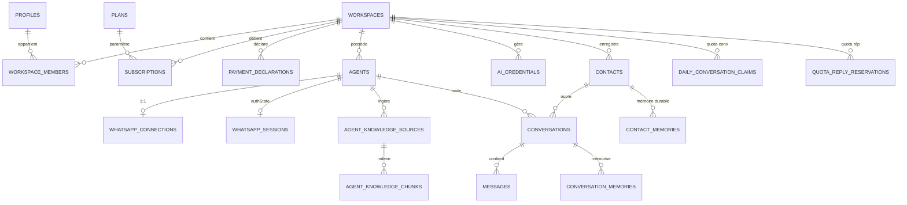

# Innoica Agent Studio — Schéma Base de Données (PostgreSQL / Supabase)

**Projet Supabase vérifié :** `qsyiatlvkyzknawfgpja`  
**RLS :** Activé sur les 24 tables applicatives (`rowsecurity = true`)  

---

## 1. Modèle Relationnel Principal

---

## 2. Tables Clés & Colonnes Vérifiées (v2.1)

### 2.1 Plans & Paramètres Commerciaux
- **`plans`** : `id`, `slug` (`free`, `starter`), `name_fr`, `name_en`, `description_fr`, `description_en`, `price_monthly_xaf`, `price_yearly_xaf`, `max_agents`, `max_connections`, `max_knowledge_docs`, `max_daily_new_conversations` (NULL = illimité), `max_daily_bot_replies_per_conv` (NULL = illimité), `history_retention_days`, `has_watermark` (`boolean`), `allowed_knowledge_types` (`text[]`), `capabilities` (`jsonb`, inclut `voice_message_understanding`), `features` (`jsonb`), `is_active`, `sort_order`.
- **`app_commercial_settings`** : `id` (`'default'`), `official_domain`, `watermark_template_fr`, `watermark_template_en`, `free_limit_notice_enabled`, `free_limit_notice_fr`, `free_limit_notice_en`, `updated_at`.
- **`subscriptions`** : `id`, `workspace_id`, `plan_id`, `billing_cycle` (`monthly` | `yearly`), `status`, `current_period_start`, `current_period_end`.
- **`payment_declarations`** : `id`, `workspace_id`, `submitted_by`, `plan_id`, `billing_cycle`, `amount_xaf`, `payment_method`, `reference`, `paid_at`, `proof_note`, `status` (`pending` | `approved` | `rejected`), `reviewed_by`, `reviewed_at`, `review_note`, `created_at`.

### 2.2 Quotas Temps Réel (`Africa/Douala`)
- **`daily_conversation_claims`** : `id`, `workspace_id`, `period_date` (`date`), `agent_id`, `contact_phone`, `conversation_id`, `created_at` — contrainte `UNIQUE(workspace_id, period_date, agent_id, contact_phone)`.
- **`quota_reply_reservations`** : `id`, `workspace_id`, `agent_id`, `conversation_id`, `contact_phone`, `period_date`, `idempotency_key` (unique), `status` (`reserved` | `confirmed` | `released`), `wa_message_id`, `release_reason`, `reserved_at`, `confirmed_at`, `released_at`.

### 2.3 Workspaces, Profils & Supervision
- **`profiles`** : `id`, `email`, `full_name`, `avatar_url`, `is_super_admin`, `account_status`, `suspended_reason`, `suspended_at`, `last_seen_at`, `created_at`, `updated_at`.
- **`workspaces`** : `id`, `name`, `slug`, `owner_id`, `plan_id`, `status` (`active` | `suspended`), `created_at`, `updated_at`.
- **`workspace_members`** : `id`, `workspace_id`, `user_id`, `role`, `created_at`.

### 2.4 Agents, WhatsApp, Connaissances & Inbox
- `agent_templates`, `agents`, `ai_credentials` (`encrypted_api_key`, `key_hint`), `whatsapp_connections`, `whatsapp_sessions`, `agent_knowledge_sources`, `agent_knowledge_chunks`, `contacts`, `conversations` (`control_mode`, `unread_count`, `internal_notes`, `preferred_language`, `clarification_state`), `messages` (`message_type` `'text' | 'audio'`, `voice_metadata` `jsonb`), `voice_processing_jobs`, `contact_memories`, `conversation_memories`, `human_handoffs`, `execution_logs`, `audit_logs`.

> Les tables historiques (`legacy_*`) ont été conservées intactes sans perte de données lors de la migration initiale.

---

## 3. Fonctions RPC SQL Actives

| Fonction | Rôle | Contrôle d'accès |
|---|---|---|
| `bootstrap_user_workspace(p_full_name)` | Initialise profil + workspace Free + abonnement Free si absent | `authenticated` (`auth.uid()`) |
| `get_workspace_quota_snapshot(p_workspace_id)` | Retourne l'instantané complet des limites, capacités (`hasVoiceUnderstanding`) et consommations du jour | Membre du workspace / Super Admin |
| `resolve_voice_entitlement(p_workspace_id)` | Résout côté serveur `hasVoiceUnderstanding` (`false` sur Free, `true` sur tout plan payant actif) | `SECURITY DEFINER` |
| `worker_ingest_audio_message(...)` | Ingère un message audio et vérifie le droit vocal AVANT téléchargement média | Worker secret / `service_role` |
| `worker_update_voice_result(...)` | Persiste transcription, qualité, compréhension et statut `voice_processing_jobs` | Worker secret / `service_role` |
| `worker_set_conversation_context(...)` | Met à jour `preferred_language` et `clarification_state` sur `conversations` | Worker secret / `service_role` |
| `resolve_effective_workspace_plan(p_workspace_id)` | Résout le plan effectif à partir de `subscriptions` actif sinon `free` | `SECURITY DEFINER` |
| `current_douala_date()` | Retourne `(NOW() AT TIME ZONE 'Africa/Douala')::DATE` | `STABLE` |
| `reserve_ai_reply_quota(...)` | Réserve atomiquement avec verrou transactionnel + idempotence | Worker secret / `service_role` |
| `confirm_ai_reply_quota(...)` | Confirme l'envoi WhatsApp effectif avec `wa_message_id` | Worker secret / `service_role` |
| `release_ai_reply_quota(...)` | Libère un slot réservé si l'envoi ou l'appel IA échoue | Worker secret / `service_role` |
| `is_workspace_member(ws_id)` / `is_super_admin()` | Helpers RLS d'isolation multi-tenant et admin | `STABLE SECURITY DEFINER` |
