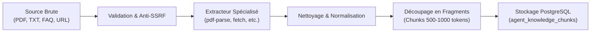

# INNOICA WhatsApp Agents — Traitement Documentaire & Connaissances (Ingestion Worker)

**Version :** 2.0  
**Statut :** Spécification Technique & Sécurité

---

## 1. Vue d'ensemble du Pipeline d'Ingestion

Le service `innoica-ingestion-worker` est responsable de la transformation de documents bruts en fragments de connaissances utilisables par les agents :

---

## 2. Types de Sources Acceptées & Règles de Validation

| Type de Source | Format & Limites | Mécanisme d'Extraction | Mesures de Sécurité |
|---|---|---|---|
| **FAQ Manuelle** | Paires Question / Réponse saisies dans l'UI | Formatage textuel direct | Validation Zod, encodage UTF-8 |
| **Documents TXT** | Fichiers texte (.txt), max 5 Mo | Lecture UTF-8 directe | Vérification MIME, scan de caractères anormaux |
| **Documents PDF** | Documents PDF (.pdf), max 10 Mo | `pdf-parse` / stream sécurisé | Validation de l'en-tête `%PDF-`, désactivation des scripts intégrés |
| **URL Publique** | Page web HTTP / HTTPS, max 5 Mo | `fetch` avec parsing HTML (Readability/Cheerio) | **Protection SSRF Stricte**, restriction IP |

---

## 3. Spécification Détaillée de la Protection Anti-SSRF (Scraping Web)

Avant d'effectuer la moindre requête HTTP pour crawler une URL soumise par l'utilisateur :

1. **Validation du Schéma :**
   - Seuls `http:` et `https:` sont acceptés. Tout autre schéma (`file:`, `ftp:`, `gopher:`, `javascript:`, etc.) est rejeté.

2. **Résolution DNS Préalable :**
   - Résolution du nom d'hôte via `dns.promises.lookup()`.
   - Inspection de l'adresse IP résolue (IPv4 et IPv6).

3. **Plages IP Bloquées (Blacklist Inviolable) :**
   - `0.0.0.0/8` (Adresses courantes)
   - `10.0.0.0/8` (Réseau privé classe A)
   - `100.64.0.0/10` (Carrier-grade NAT)
   - `127.0.0.0/8` (Loopback / Localhost)
   - `169.254.0.0/16` (Link-local et endpoints métadonnées AWS/GCP/DigitalOcean/Contabo)
   - `172.16.0.0/12` (Réseau privé classe B)
   - `192.0.0.0/24` (IETF Protocol Assignments)
   - `192.0.2.0/24` (TEST-NET-1)
   - `192.168.0.0/16` (Réseau privé classe C)
   - `198.18.0.0/15` (Network benchmark)
   - `198.51.100.0/24` (TEST-NET-2)
   - `203.0.113.0/24` (TEST-NET-3)
   - `224.0.0.0/4` (Multicast)
   - `240.0.0.0/4` (Réservé)
   - `::1` (IPv6 loopback)
   - `fc00::/7` (IPv6 Unique Local)
   - `fe80::/10` (IPv6 Link-Local)

4. **Contrôle des Redirections :**
   - `redirect: 'manual'`.
   - Chaque en-tête `Location` est re-soumis à la chaîne de validation DNS et IP complète.
   - Maximum 3 sauts de redirection.

---

## 4. Stratégie de Chunking & RAG

- **Taille de fragment :** 500 à 1 000 caractères avec un chevauchement (overlap) de 100 caractères pour préserver la continuité du sens.
- **Indexation :**
  - PostgreSQL Full-Text Search (`tsvector`, dictionnaire bilingue français/anglais).
  - Préparation pour extension vectorielle `pgvector` avec embeddings optionnels.
- **Isolation :**
  - Chaque chunk est taggué avec `agent_id` et `source_id`.
  - La recherche de contexte ne retourne que les fragments autorisés pour l'agent en cours d'exécution.
